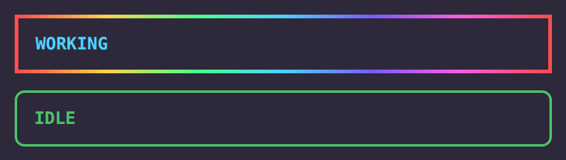

# Claude Mods by arandevcode

Suite of mods for [Claude Code](https://claude.com/claude-code).

> 🔁 Want the same on OpenCode? See [opencode-plugins](https://github.com/arandevcode/opencode-plugins).

<br>
<p align="center">🐟</p>
<p align="center">
  <em>&ldquo;Quien quiera peces que se moje el culo&rdquo;</em><br>
  <em>&ldquo;If you want fish, get your ass wet&rdquo;</em><br>
  <sub>— my father taught me that</sub>
</p>
<p align="center">
  <a href="https://buymeacoffee.com/arandevcode"><strong>☕ Buy me a coffee</strong></a>
  <br>
  <sub><a href="https://github.com/sponsors/arandevcode">❤️ Sponsor on GitHub</a></sub>
</p>

| Mod | Type | Mirrors | Version | Description |
|-----|------|---------|---------|-------------|
| glow-thinking | `🧩 mod` | `opencode-thinking` | 0.1.0 | IDLE / WORKING band above the prompt and a gradient border around every side panel: green at rest, rotating rainbow while Claude works. /thinking shows time per model. |
| quota-panel | `🧩 mod` | `opencode-quota-extended` | 0.1.1 | Side panel with your Claude rate-limit windows (5h / weekly): bars, % left, reset time and pace, plus session cost and toasts at 80/90/95%. |

## Install

```
/plugin install glow-thinking --marketplace arandevcode/claude-mods
/plugin install quota-panel --marketplace arandevcode/claude-mods
```

At the prompt of a terminal session. Each mod is independent.

<p align="center">
  
  &nbsp;&nbsp;&nbsp;
  
  <br>
  <sub><em>glow-thinking</em> &nbsp;&nbsp;&nbsp;&nbsp;&nbsp;&nbsp;&nbsp;&nbsp; <em>quota-panel</em></sub>
</p>

## Uninstall

```
/plugin uninstall glow-thinking
/plugin uninstall quota-panel
```
