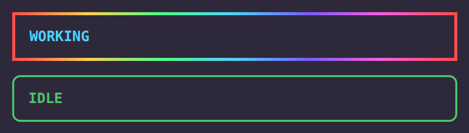

<p align="center">
  
  <br>
  <sub><em>Bandas IDLE y WORKING con borde en degradado (datos inventados)</em></sub>
</p>

# glow-thinking

Banda IDLE / WORKING sobre el prompt y borde en degradado alrededor de cada panel lateral: verde en reposo, arcoíris giratorio mientras Claude trabaja. `/thinking` muestra el tiempo por modelo.

Mod de Claude Code, espejo de [`opencode-thinking`](https://github.com/arandevcode/opencode-plugins/tree/main/opencode-thinking) para OpenCode. Funciona en local, sin telemetría y sin red.

> 🇬🇧 Also available in [English](README.md)

> 🔁 ¿Quieres esto en OpenCode? Mira [opencode-thinking](https://github.com/arandevcode/opencode-plugins/tree/main/opencode-thinking).

## Instalar

```
/plugin install glow-thinking --marketplace arandevcode/claude-mods
```

Desde una shell: `claude plugin install glow-thinking --marketplace arandevcode/claude-mods`.

## Notas

- El nombre del mod ordena antes que `quota-panel` a propósito: su borde envuelve cada panel, y un panel dibujado por un mod que cargue antes se lo ocultaría.
- `/thinking` lista el tiempo de trabajo por modelo, guardado entre sesiones.
