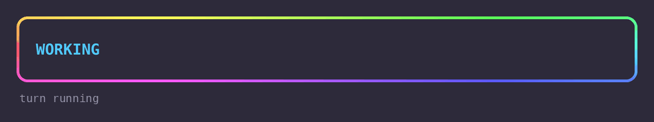
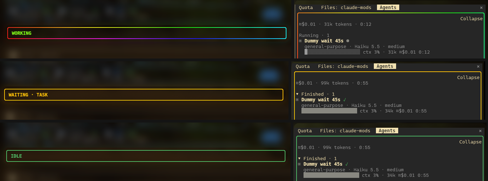

<p align="center">
  
  <br>
  <sub><em>WORKING → WAITING → IDLE over a turn with a subagent and a background task (made-up data)</em></sub>
</p>

# glow-thinking

A status band above the prompt and a gradient border around every side panel that tell you, at a glance, whether Claude is busy, waiting on background work, or done. `/thinking` shows time per model.

Claude Code mod, mirror of [`opencode-thinking`](https://github.com/arandevcode/opencode-plugins/tree/main/opencode-thinking) for OpenCode. Runs locally, no telemetry, no network.

> 🇪🇸 También disponible en [Español](README-es.md)

> 🔁 Want this on OpenCode? See [opencode-thinking](https://github.com/arandevcode/opencode-plugins/tree/main/opencode-thinking).

## States

| Band | Border | Meaning |
| --- | --- | --- |
| `WORKING` | rotating rainbow | The main turn **or any subagent** is running. |
| `WAITING · MONITOR` / `TASK` / `SCHEDULE` | amber | The turn is over but a monitor, a background task or a scheduled wakeup is still alive (counts shown, e.g. `WAITING · 2 TASKS`). |
| `IDLE` | green | Nothing running and nothing pending. |

A background shell, including the Monitor tool, shows as `TASK`; `MONITOR` is for MCP monitors. A background task finishing wakes the session with a new turn, so the band goes back to `WORKING` and then to `IDLE`.

<p align="center">
  
</p>

## Install

```
/plugin install glow-thinking --marketplace arandevcode/claude-mods
```

From a shell: `claude plugin install glow-thinking --marketplace arandevcode/claude-mods`.

## Updating

Run `/plugin update glow-thinking`, then **restart the session**: a loaded mod is not replaced in a running session (`/reload-plugins` is not enough). If the plugin is installed in more than one scope, update each one, e.g. `claude plugin update glow-thinking@arandevcode-mods --scope user`.

## Notes

- The mod's name sorts before `quota-panel` on purpose: its border wraps every panel, and a panel drawn by a mod that loads earlier would hide it from the border.
- `/thinking` lists working time per model, kept across sessions.
