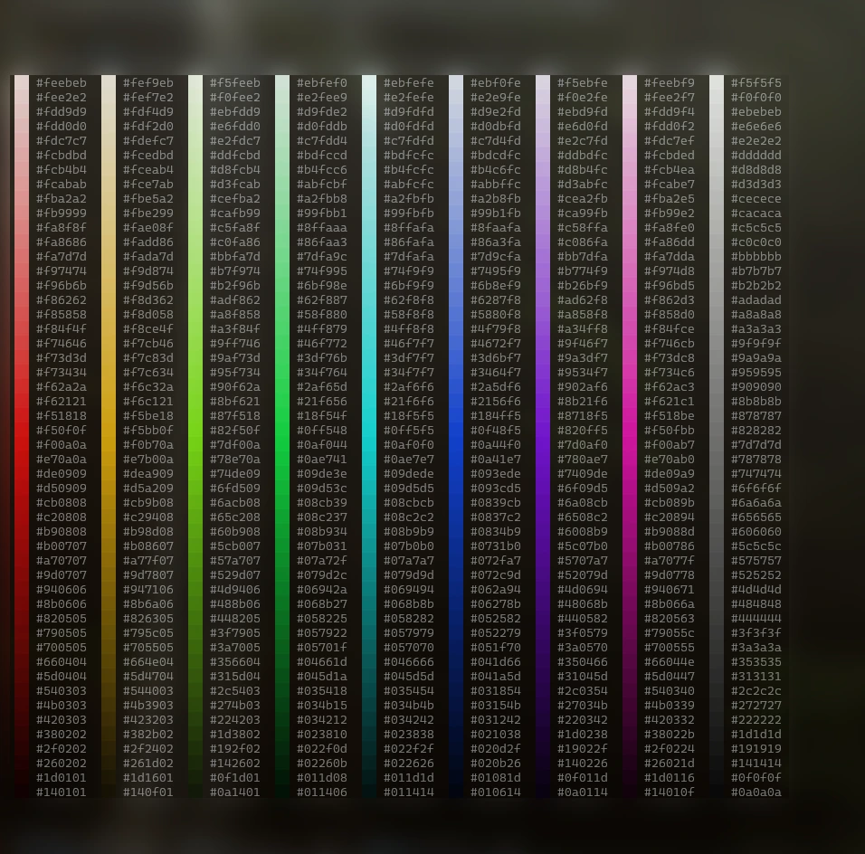
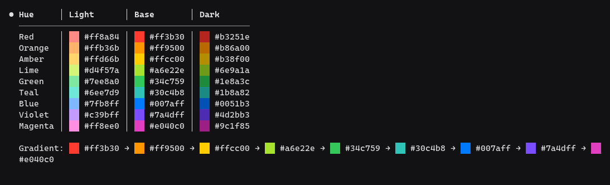

<p align="center">
  
  <br>
  <sub><em>50 niveles de luminosidad, 8 matices y una columna de grises, en una sesión real; lo que no es el mod está desenfocado</em></sub>
</p>

# hex-swatch

Muestra un pequeño cuadrado de color junto a cada color hexadecimal de las respuestas de Claude, de modo que `#ff7f2a` se lee como ██ `#ff7f2a` de un vistazo. Nada que aprender: pregunta a Claude por una paleta, un tema o un token CSS y los colores se dibujan.

Mod de Claude Code. Funciona en local, sin telemetría, sin red y sin leer ni escribir archivos.

> 🇬🇧 Also available in [English](README.md)

## Qué dibuja

<p align="center">
  
  <br>
  <sub><em>Una tabla y una línea de degradado en la misma sesión</em></sub>
</p>

```
--primary        ██ #3b82f6   ██ #1d4ed8
--primary-soft   ██ #dbeafe   ██ #eff6ff

La base ██ #1d4ed8 da unos 6,7:1 con texto blanco.
```

- Colores `#rgb`, `#rrggbb` y `#rrggbbaa` (el alfa se ignora en el cuadrado).
- Texto, listas, títulos, citas, tablas, código en línea y bloques de código.
- `#123` y otras referencias a issues se dejan como están: un código de 3 dígitos necesita una letra de la `a` a la `f`. `&#123456;` tampoco es un color.

## Instalar

```
/plugin install hex-swatch --marketplace arandevcode/claude-mods
```

Desde una shell: `claude plugin install hex-swatch --marketplace arandevcode/claude-mods`. Después `/reload-plugins`.

## Actualizar

Ejecuta `/plugin update hex-swatch` y **reinicia la sesión**: un mod ya cargado no se sustituye en una sesión en marcha (`/reload-plugins` no basta). Si el plugin está instalado en más de un ámbito, actualiza cada uno, p. ej. `claude plugin update hex-swatch@arandevcode-mods --scope user`.

## Requisitos

Claude Code con soporte de mods, probado en la 2.1.322. Solo usa `ui.render`, así que no necesita nada más instalado.

## Opciones

Las dos tienen valor por defecto: basta con instalar, y el aviso de "opciones sin configurar" tras instalar se puede ignorar. Se cambian en `/config` o en `settings.json`, en `pluginConfigs["hex-swatch@<marketplace>"].options`.

| Opción | Valores | Por defecto |
| --- | --- | --- |
| `glyph` | `██`, `■`, `●`, `▮▮` | `██` |
| `codeBlocks` | `squares`, `keep` | `squares` |

`squares` redibuja un bloque de código que lleva un color como filas simples con los cuadrados, así que pierde el resaltado de sintaxis. `keep` lo deja como está, sin cuadrados.

`██` es lo más alto que puede dibujar una terminal: llena toda la línea y, con dos celdas de ancho, queda casi cuadrado.

## Convive con otros mods

- **Otro mod dibuja las respuestas** (un skin, por ejemplo): `hex-swatch` conserva su aspecto y añade los cuadrados a lo que dibujó: texto, tablas (las columnas se ensanchan para el cuadrado), bloques de código y párrafos markdown. No lo necesita: sin ese mod funciona por su cuenta, como se explica abajo. Para eso tiene que ir **antes** que ese mod en `enabledPlugins`, porque un mod colocado antes envuelve a los que van detrás. Si junto a un skin no salen los cuadrados, sube `hex-swatch`.
- **Nada más dibuja las respuestas**: `hex-swatch` redibuja solo los bloques que llevan un color. Títulos, listas, citas y tablas conservan su forma; la negrita se mantiene; el código en línea y los enlaces pierden su marcado. Los bloques sin color no se tocan.

## Claude Team y Enterprise

El guard de la organización se salta algunos hooks de los mods instalados y avisa por cada uno. `hex-swatch` no usa ninguno, así que carga sin avisos.

## Límites

- Solo el texto de Claude. No cubre la salida de Bash, los resultados de herramientas ni los diffs.
- Los colores muy oscuros casi no se ven en una terminal oscura.
- Un árbol que no conoce (un `Markdown` con enlaces pulsables dibujado por otro mod) se deja como está.

## Notas

- Solo redibuja una respuesta si lleva un color, así que para el resto no cuesta nada.
