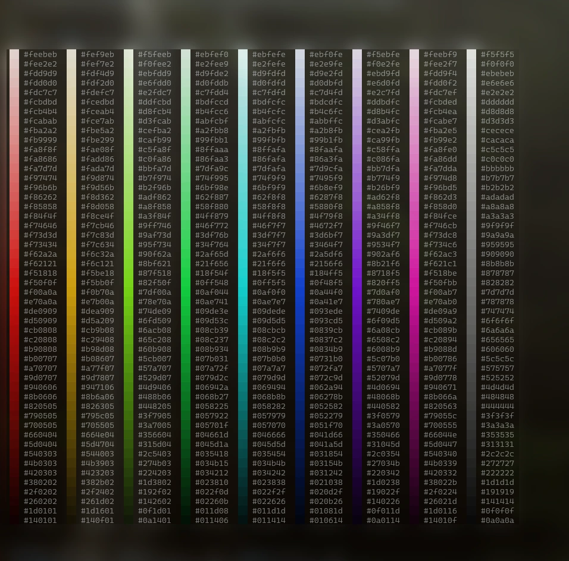
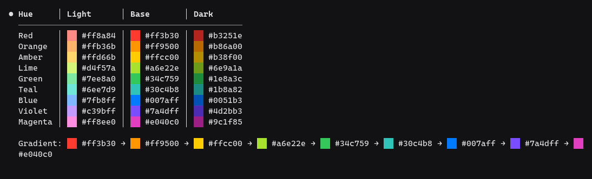

<p align="center">
  
  <br>
  <sub><em>50 levels of lightness, 8 hues and a grey column, in a real session; everything that is not the mod is blurred</em></sub>
</p>

# hex-swatch

Shows a small color square next to every hex color in Claude's replies, so `#ff7f2a` reads as ██ `#ff7f2a` at a glance. Nothing to learn: ask Claude about a palette, a theme or a CSS token and the colors are drawn.

Claude Code mod. Runs locally, no telemetry, no network, no files read or written.

> 🇪🇸 También disponible en [Español](README-es.md)

## What it draws

<p align="center">
  
  <br>
  <sub><em>A table and a gradient line in the same session</em></sub>
</p>

```
--primary        ██ #3b82f6   ██ #1d4ed8
--primary-soft   ██ #dbeafe   ██ #eff6ff

The base ██ #1d4ed8 gives about 6.7:1 against white text.
```

- Colors in `#rgb`, `#rrggbb` and `#rrggbbaa` (the alpha is ignored for the square).
- Plain text, lists, headings, quotes, tables, inline code and code blocks.
- `#123` and other issue references are left alone: a 3-digit code needs a letter from `a` to `f`. `&#123456;` is not a color either.

## Install

```
/plugin install hex-swatch --marketplace arandevcode/claude-mods
```

From a shell: `claude plugin install hex-swatch --marketplace arandevcode/claude-mods`. Then `/reload-plugins`.

## Updating

Run `/plugin update hex-swatch`, then **restart the session**: a loaded mod is not replaced in a running session (`/reload-plugins` is not enough). If the plugin is installed in more than one scope, update each one, e.g. `claude plugin update hex-swatch@arandevcode-mods --scope user`.

## Requirements

Claude Code with mods support, tested on 2.1.322. It uses only `ui.render`, so it needs nothing else installed.

## Options

Both have defaults: installing is enough, and the "options not yet set" notice after installing can be ignored. Change them in `/config` or in `settings.json` under `pluginConfigs["hex-swatch@<marketplace>"].options`.

| Option | Values | Default |
| --- | --- | --- |
| `glyph` | `██`, `■`, `●`, `▮▮` | `██` |
| `codeBlocks` | `squares`, `keep` | `squares` |

`squares` redraws a code block that holds a color as plain rows with the squares, so it loses its syntax highlighting. `keep` leaves it as it is, without squares.

`██` is the tallest a terminal can draw: it fills the whole line and, two cells wide, is almost square.

## Works with other mods

- **Another mod draws the replies** (a skin, for example): `hex-swatch` keeps its look and adds the squares to what it drew: text, tables (the columns are widened to fit the square), code blocks and markdown paragraphs. It does not need that mod: without one it works on its own, as below. For that it has to sit **before** that mod in `enabledPlugins`, because a mod placed first wraps the ones after it. If the squares do not appear next to a skin, move `hex-swatch` up.
- **Nothing else draws the replies**: `hex-swatch` redraws only the blocks that hold a color. Headings, lists, quotes and tables keep their shape; bold stays bold; inline code and links lose their markup. Blocks with no color are untouched.

## Claude Team and Enterprise

The organization's guard skips some hooks of installed mods and prints a notice for each. `hex-swatch` uses none of them, so it loads without notices.

## Limits

- Only Claude's own text. Bash output, tool results and diffs are not covered.
- Very dark colors are barely visible on a dark terminal.
- A tree it does not know (a `Markdown` element with pressable links drawn by another mod) is left as it is.

## Notes

- It redraws a reply only when the reply holds a color, so the cost is nil for the rest.
