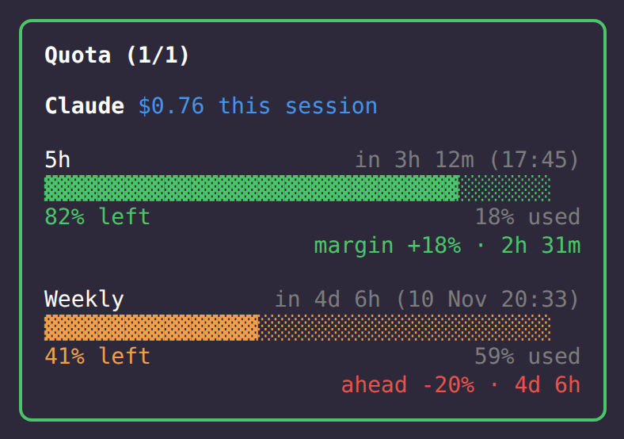

<p align="center">
  
  <br>
  <sub><em>Panel lateral de cuota (datos inventados)</em></sub>
</p>

# quota-panel

Panel lateral con tus ventanas de límite de Claude (5h / semanal): barras, % restante, hora de reinicio y ritmo, más el coste de la sesión y avisos al 80/90/95 %.

Mod de Claude Code, espejo de [`opencode-quota-extended`](https://github.com/arandevcode/opencode-plugins/tree/main/opencode-quota-extended) para OpenCode. Funciona en local, sin telemetría y sin red.

> 🇬🇧 Also available in [English](README.md)

> 🔁 ¿Quieres esto en OpenCode? Mira [opencode-quota-extended](https://github.com/arandevcode/opencode-plugins/tree/main/opencode-quota-extended).

## Instalar

```
/plugin install quota-panel --marketplace arandevcode/claude-mods
```

Desde una shell: `claude plugin install quota-panel --marketplace arandevcode/claude-mods`.

## Notas

- Necesita una suscripción de Claude: las ventanas de 5h y semanal salen de los datos de límite de Claude Code. Sin ella el panel solo muestra el coste de la sesión.
- Se abre con `/quota`; también se abre al iniciar la sesión.
