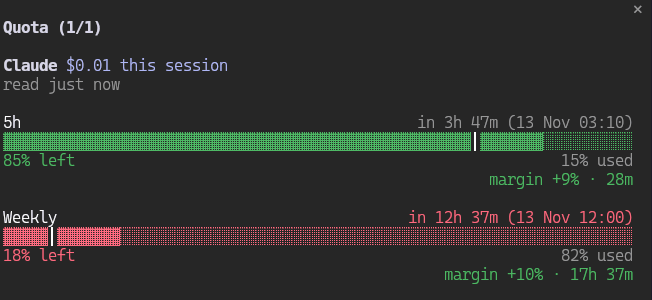

<p align="center">
  
  <br>
  <sub><em>Fresh reading, then flagged as stale after 10 minutes, then refreshed (made-up data)</em></sub>
</p>

# quota-panel

Side panel with your Claude rate-limit windows (5h / weekly): bars, % left, reset time and pace, plus session cost and toasts at 80/90/95%.

Claude Code mod, mirror of [`opencode-quota-extended`](https://github.com/arandevcode/opencode-plugins/tree/main/opencode-quota-extended) for OpenCode. Runs locally, no telemetry, no network.

> 🇪🇸 También disponible en [Español](README-es.md)

> 🔁 Want this on OpenCode? See [opencode-quota-extended](https://github.com/arandevcode/opencode-plugins/tree/main/opencode-quota-extended).

## Install

```
/plugin install quota-panel --marketplace arandevcode/claude-mods
```

From a shell: `claude plugin install quota-panel --marketplace arandevcode/claude-mods`.

## Notes

- Needs a Claude subscription: the 5h and weekly windows come from Claude Code's own rate-limit data. Until the first response of the session reports them (or without a subscription) the panel waits and only shows the session cost.
- Open it with `/quota`; it also opens when a session starts.
- Under the title it says how long ago the numbers were read (`read 3m ago`). The limits only refresh when a response reports them, so after 10 minutes it turns amber (`⚠ read 14m ago · send a message to refresh`), and a window that reset since the reading is flagged instead of shown as current.
- Each bar carries a one-cell tick `│` marking the share of the window still ahead (time left). Fill to the left of the tick means you are within pace; fill to the right means you are spending faster than the clock. Windows without a reset time show no tick.
